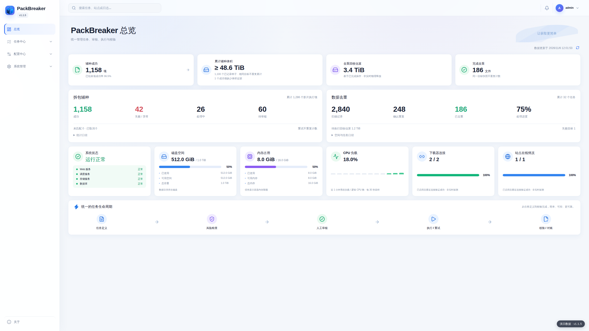
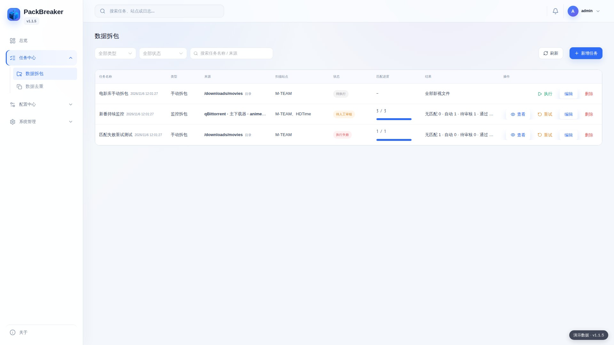
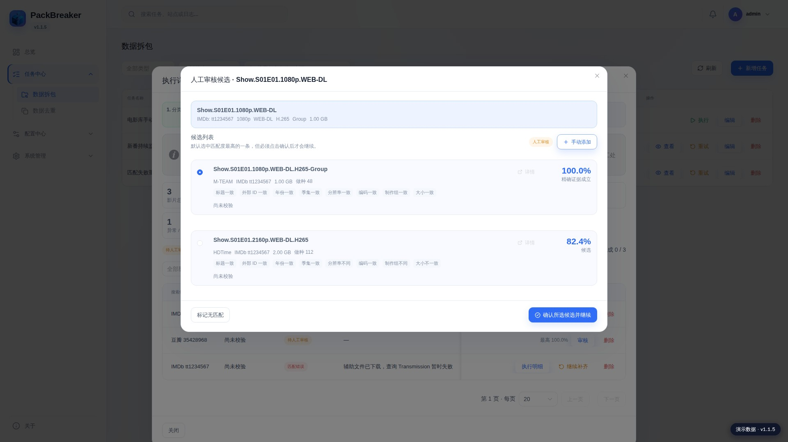
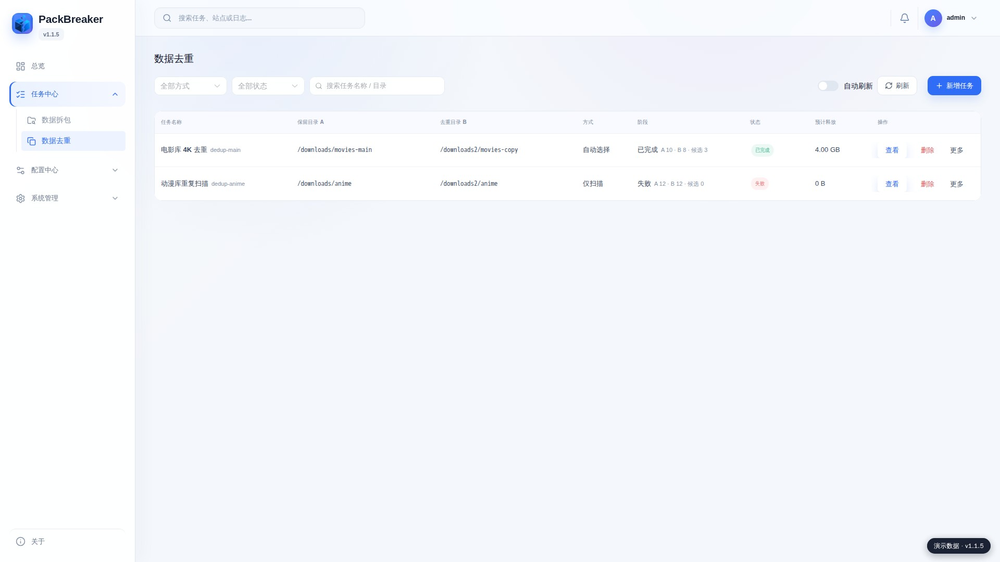
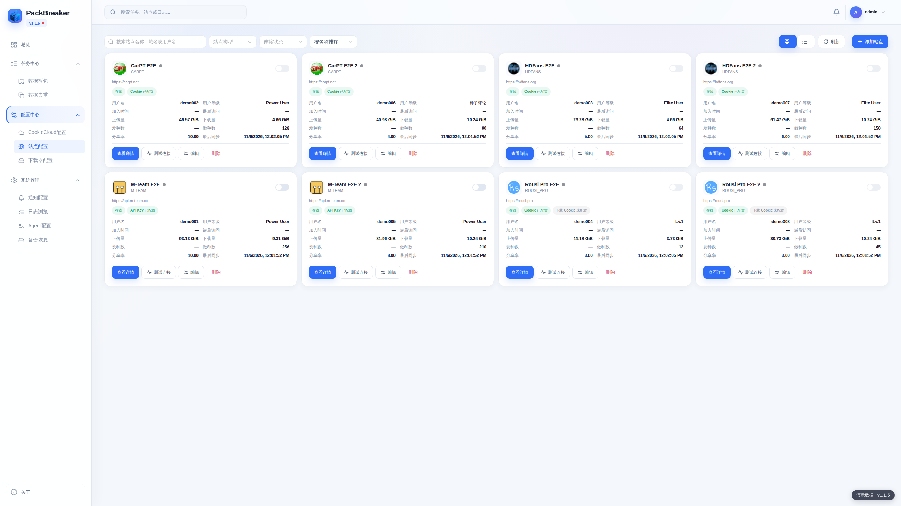

<h1 align="center">PackBreaker</h1>

<p align="center"><strong>面向 PT 场景的自动拆包与安全辅种系统</strong></p>

<p align="center">从媒体目录或 qBittorrent / Transmission 任务出发，自动完成影片发现、跨站匹配、内容验证、文件复用与做种管理。</p>

<p align="center">
  
  
  
</p>

<p align="center">
  <a href="#功能速览">功能速览</a> ·
  <a href="#界面速览">界面速览</a> ·
  <a href="#工作流">工作流</a> ·
  <a href="#快速开始docker">快速开始</a> ·
  <a href="#docker-部署方案">Docker 部署</a> ·
  <a href="#安全边界">安全边界</a> ·
  <a href="#本地开发">本地开发</a>
</p>



## 一句话理解

PackBreaker 把「拆包 → 搜站 → 验证 → 复用 → 辅种」这条原本靠手工完成的链路，做成一条**有证据、有审核、可恢复**的自动化流水线。

它不靠文件名猜内容：候选必须通过 **Piece 级内容验证**；证据不足时会停下来等待人工审核或直接阻断，而不是冒险执行。

## 功能速览

| 模块 | 你能用它做什么 |
| --- | --- |
| **数据拆包** | 从媒体目录或下载器任务发现影片；创建手动 / 监控任务，跨站搜索候选，审核后完成验证、物化与辅种 |
| **内容验证** | BitTorrent v1 / v2 / hybrid 的 Piece 级校验，覆盖跨文件 Piece、Merkle、padding 等场景 |
| **文件复用** | 优先 Hardlink，必要时 COPY；写入前强制隔离 inode，保护源文件 |
| **数据去重** | 扫描重复影片，完整 SHA-256 核验，人工确认后安全复用并估算可回收空间 |
| **站点与下载器** | 多站点 Profile、Cookie / API Key、CookieCloud 同步；qBittorrent / Transmission 连接、指标与路径映射 |
| **通知与 AI** | Telegram、Server酱、站内通知；OpenAI-compatible 模型与只读 AI 助手 |
| **系统运维** | 总览仪表盘、脱敏日志、健康诊断、备份恢复、在线升级与异常对账 |

## 界面速览

以下截图来自当前主工作区的 v1.1.5 前端生产构建，使用脱敏演示数据展示典型场景；实际站点、任务与统计以部署实例为准。

### 任务中心：手动与监控拆包

一次创建、持续运行；任务列表直接展示成功、失败与待审核数量，执行记录可下钻到每一步。



### 候选审核：匹配证据与内容验证

每个候选都带标题、大小、站点来源与验证结果；只有证据完整的候选才允许进入执行计划。



### 数据去重：重复影片与回收估算

按完整内容哈希确认重复关系，人工确认后复用文件，并区分「已完成」与「待执行」的回收空间。



### 配置中心：站点、下载器与 CookieCloud

站点凭证加密保存、连接测试与状态可视；下载器路径映射一眼看清。



## 工作流


> 候选匹配 ≠ 内容通过。未满足安全条件的任务会进入待审核、重试或阻断状态。

## 快速开始（Docker）

推荐使用 **Docker Compose**。保存为 `compose.yaml`，按实际情况修改媒体目录与 `PUID` / `PGID`：

```yaml
services:
  packbreaker:
    image: ghcr.io/yyxiaoma/packbreaker:stable
    container_name: packbreaker
    restart: unless-stopped
    ports:
      - "8000:8000"
    environment:
      PUID: "1000"
      PGID: "1000"
      PACKBREAKER_TIMEZONE: "Asia/Shanghai"
      # 反向代理场景：填写代理的 IP 或 CIDR，多个用逗号分隔
      # PACKBREAKER_TRUSTED_PROXIES: "172.17.0.1/32"
    volumes:
      - packbreaker-config:/config          # 数据库、配置与凭证，必须持久化
      - /path/to/downloads:/downloads        # 媒体目录，可挂多个
      # - /path/to/downloads2:/downloads2
      # 可选：Web 一键升级（等价于授予容器 Docker 主机管理权限）
      # - /var/run/docker.sock:/var/run/docker.sock
    security_opt:
      - no-new-privileges:true

volumes:
  packbreaker-config:
```

```bash
docker compose pull
docker compose up -d
docker logs packbreaker
```

浏览器访问 **`http://服务器IP:8000`**。默认管理员用户名为 `admin`；首次启动的临时密码从容器日志获取，登录后按提示修改。

- 生产环境请固定正式版本标签或不可变 digest，不要只依赖可移动标签。
- 媒体目录必须在宿主机真实存在，且 `PUID` / `PGID` 对它有读写权限。
- Hardlink 要求源与目标位于同一文件系统；无法硬链接时才按执行计划使用 COPY。
- 不挂载 `docker.sock` 时，用 `docker compose pull && docker compose up -d` 升级；Web 一键升级需要该高权限挂载。

## Docker 部署方案

除 Compose 外，仓库提供完整的部署与运维说明：[**Docker 部署指南**](docs/deployment.md)。

| 方案 | 适用场景 | 入口 |
| --- | --- | --- |
| **Docker Compose** | 绝大多数 Linux 服务器、NAS、长期运行 | 上方示例，或 [部署指南 § Compose](docs/deployment.md#方案一docker-compose推荐) |
| **docker run** | 单容器、不想引入 Compose | [部署指南 § docker run](docs/deployment.md#方案二docker-run单容器) |
| **群晖 Container Manager** | 群晖 NAS 图形化部署 | [部署指南 § 群晖](docs/deployment.md#方案三群晖-container-manager) |
| **反向代理 / HTTPS** | 需要域名访问、统一入口 | [部署指南 § 反向代理](docs/deployment.md#反向代理与-https) |

部署指南同时覆盖：目录与权限、Hardlink 文件系统要求、升级与回滚、`/config` 备份、健康检查与常见故障。

## 安全边界

PackBreaker 的自动化建立在三条不可交换的前提下：

1. **先验证，再执行**——内容无法被严格证明时，不自动批准。
2. **源数据只读**——任何修复写入前先隔离为独立 inode；辅种可以失败，源文件不能损坏。
3. **副作用可追溯**——下载器与文件系统动作都经过 operation journal，中断后优先对账与恢复。

自动批准默认保持关闭；候选分数或文件名相同不能替代内容验证和执行安全门。

## 支持范围

| 项目 | 当前支持 |
| --- | --- |
| 运行平台 | Linux `amd64` / `arm64` 容器 |
| 下载器 | qBittorrent、Transmission |
| 站点 | 内置多站点 Profile，支持 Cookie / API Key 与 CookieCloud |
| 数据库 | SQLite（持久化在 `/config`） |

新版本下载器、站点类型或文件系统，只有取得协议与真实链路证据后才会扩大支持范围；无法证明时保持阻断或人工处理。详见 [支持矩阵](docs/support-matrix.md) 与 [已知限制](docs/known-limitations.md)。

## 本地开发

需要 **Python 3.11、uv、Node.js 22.12+ 和 Corepack / pnpm**。

```bash
uv sync --frozen --all-groups
corepack enable
corepack pnpm --dir frontend install --frozen-lockfile

mkdir -p runtime/dev/config runtime/dev/data
PACKBREAKER_CONFIG_DIR="$PWD/runtime/dev/config" \
PACKBREAKER_DATA_DIR="$PWD/runtime/dev/data" \
uv run python -m backend.app.server
```

另开终端执行 `corepack pnpm --dir frontend dev`，访问 `http://127.0.0.1:5173`（API 代理到本地 8000 端口）。

```bash
uv run python scripts/check.py   # 静态检查、类型检查与契约检查
uv run python scripts/test.py    # 后端测试、前端测试与构建
```

技术栈：Python 3.11 / FastAPI / SQLAlchemy / Alembic / SQLite；Vue 3 / TypeScript / Vite / Element Plus / Pinia；Docker / Compose / GitHub Actions。更多说明见 [开发文档](docs/README.md) 与 [AGENTS.md](AGENTS.md)。

## 文档

| 文档 | 内容 |
| --- | --- |
| [Docker 部署指南](docs/deployment.md) | Compose、docker run、群晖、反向代理、升级回滚与备份 |
| [项目文档索引](docs/README.md) | 功能入口、统计口径、架构导航与故障排查 |
| [支持矩阵](docs/support-matrix.md) | 平台、下载器、站点与文件系统边界 |
| [已知限制](docs/known-limitations.md) | 当前有意保留的限制 |
| [测试说明](docs/testing.md) | 质量门与测试范围 |
| [AGENTS.md](AGENTS.md) | 开发约束与安全不变量 |

## 贡献

欢迎通过 [Issues](https://github.com/YYxiaoma/PackBreaker/issues) 提交问题与建议，或通过 Pull Request 参与开发。提交前请阅读 [AGENTS.md](AGENTS.md)，并运行与变更范围相关的检查和测试；涉及文件操作或下载器写入的修改须保留安全与恢复机制。

## License

本项目采用 [MIT License](LICENSE)。
